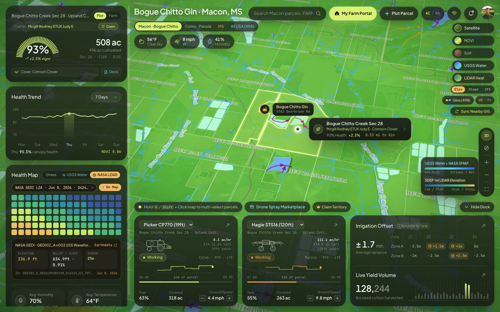
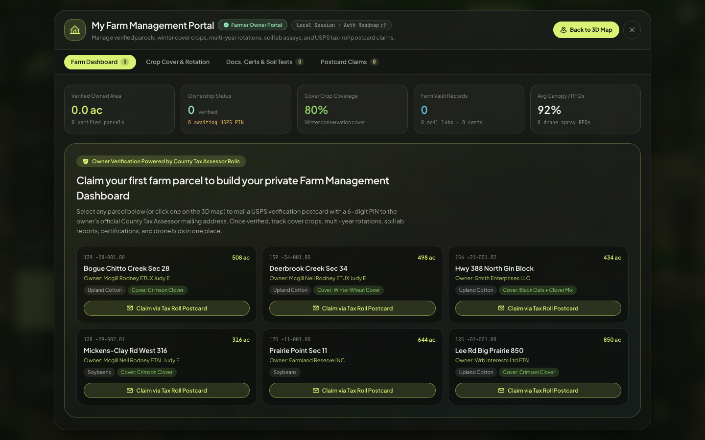
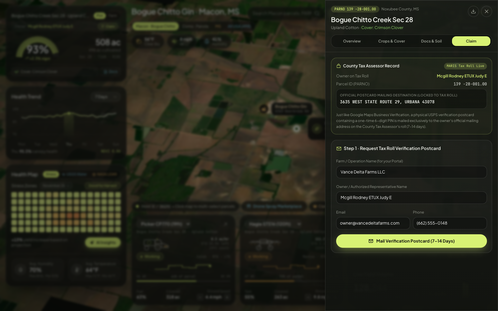
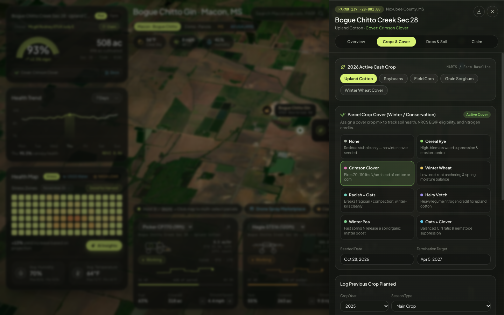
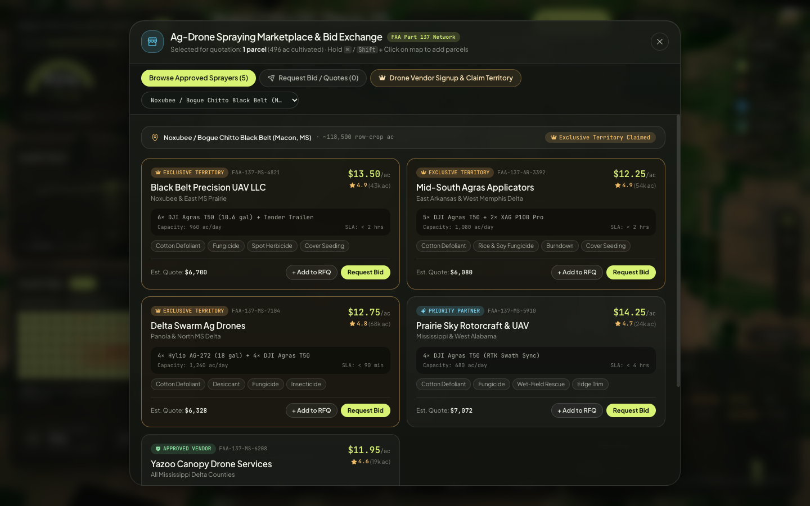
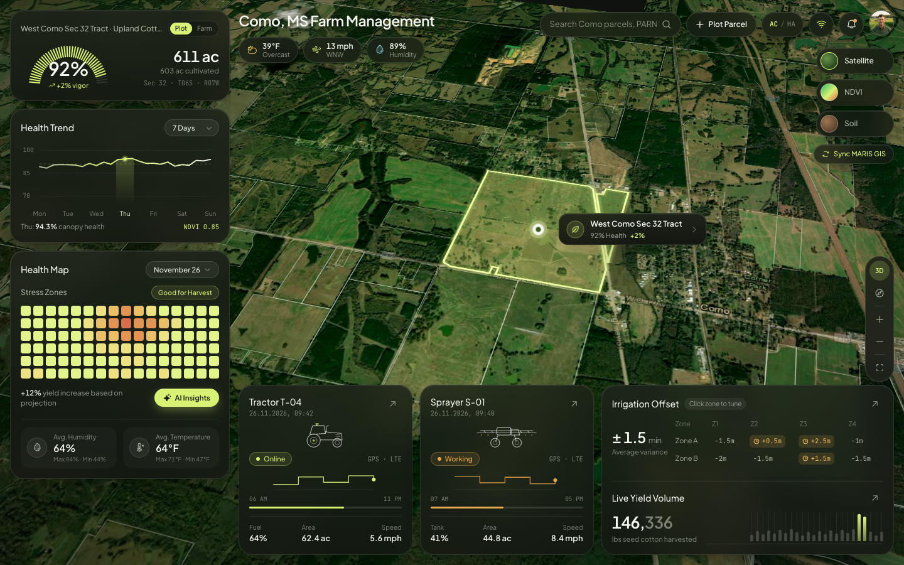

# DeltaPlot — Precision Parcel Farm Management System

**Live Deployment:** [https://delta-parcel-fms.vercel.app](https://delta-parcel-fms.vercel.app) · **Repository:** [github.com/sardoru/delta-parcel-fms](https://github.com/sardoru/delta-parcel-fms) · **Auth Roadmap:** [Issue #1](https://github.com/sardoru/delta-parcel-fms/issues/1)

A parcel-first precision agriculture operations cockpit and farmer owner portal built on **official multi-state county cadastral farmland parcels**, **live federal USGS & NASA hydrological/LiDAR intelligence**, **498 verified U.S. Cotton Gins & Warehouses**, an **Ag-Drone Spraying Marketplace**, and **Google-Maps-style County Tax Assessor postcard ownership verification**.


---

## Feature Showcase

### Live USGS Water / Drainage + NASA SMAP & USGS 3DEP 1-Meter LiDAR Map Overlays
Toggle federal raster heatmaps directly onto the 3D satellite map from either the right-side map rail or inside the left **Health Map** panel (`USGS Water` + `NASA LiDAR` tabs):
- **USGS US Topo Overlay** ([Open Live](https://delta-parcel-fms.vercel.app/?overlay=topo)) — Streams official **USGS The National Map US Topo** topographic quad tiles (contour lines, elevation shading, benchmarks, and hydrography) blended cleanly beneath parcel boundaries.
- **USGS Water + NASA SMAP** ([Open Live](https://delta-parcel-fms.vercel.app/?overlay=water&healthTab=water)) — Streams live **USGS NHD** creeks & drainage channels, **USGS WBD HUC-12** watershed boundaries, and **NASA GIBS SMAP L4** surface soil moisture tiles alongside live **USGS National Water Dashboard** stream gages & **FEMA NFHL** flood zones.
- **USGS 3DEP 1m LiDAR Heatmap** ([Open Live](https://delta-parcel-fms.vercel.app/?overlay=lidar&healthTab=lidar)) — Streams live 1-meter LiDAR elevation tiles with inline **`Elev` | `Slope` | `2ft`** contour switching plus selectable **NASA GEDI L2A** & **ICESat-2 ATL08** orbital LiDAR scans.



### Farmer Owner Portal & Farm Management Dashboard
Verify ownership of your parcels to manage your entire farm portfolio from a dedicated owner dashboard ([Open Portal](https://delta-parcel-fms.vercel.app/?mode=portal)):
- **Portfolio KPIs:** Verified owned acreage, pending USPS postcard claims, winter cover crop coverage %, uploaded soil tests & certifications, and active drone RFQs.
- **4 Dedicated Portal Views:** `Farm Dashboard`, `Crop Cover & Rotation` (multi-year cross-parcel matrix), `Docs, Certs & Soil Tests` (unified Farm Vault), and `Postcard Claims` (USPS PIN verification ledger).



### County Tax Assessor Postcard Ownership Claiming (Google-Maps-Style Verification)
Prevent unauthorized parcel claims using live County Tax Roll verification ([Open Claim Flow](https://delta-parcel-fms.vercel.app/?drawer=claim)):
- Queries live **MS MARIS County Tax Assessor records** (`MAILADD1`, `MCITY1`, `MZIP1`) to retrieve the owner's official mailing address on file and locks the USPS verification postcard exclusively to that address (`7–14 day` USPS delivery + one-time 6-digit PIN).
- Includes a sandbox postcard preview so reviewers can test the full claim → PIN verification → `✓ Verified Owner` badge → Farmer Portal workflow end-to-end.
- Future production authentication, server-side Lob/PostGrid postcard dispatch, and private cloud document storage are tracked in [GitHub Issue #1](https://github.com/sardoru/delta-parcel-fms/issues/1).



### Parcel Crop Cover, Multi-Season Crop History & Document / Soil Test Vault
Manage agronomic history and compliance records directly on every parcel ([Open Crops & Cover](https://delta-parcel-fms.vercel.app/?drawer=crops) · [Open Docs & Soil Vault](https://delta-parcel-fms.vercel.app/?drawer=documents)):
- **Active Cash Crop & Winter Cover Crop:** Assign cash crops and winter conservation covers (`Cereal Rye`, `Crimson Clover`, `Winter Wheat Cover`, `Tillage Radish + Oats`, `Hairy Vetch`, `Austrian Winter Pea`, `Black Oats + Clover Mix`) with seeded date & termination targets.
- **Previous Crops Planted:** Log multi-year crop rotations (`Main Crop`, `Fall/Winter Cover`, `Double-Crop`), varieties, tillage practices, and yield notes.
- **Document, Certification & Soil Test Uploads:** Drag-and-drop `PDF`, `CSV`, `PNG`, `JPG`, `XLSX`, or `DOCX` files across 6 categories (`Soil Test`, `Certification`, `FSA / USDA Form`, `Spray / Drone Record`, `Deed / Tax Roll`, `Other`) with structured soil lab assay inputs (**pH, OM %, N, P, K, CEC**).



### Ag-Drone Spraying Marketplace, Multi-Parcel RFQs & Exclusive Territory Claims
Hold **`⌘` / `Ctrl` / `Shift` + Click** on the map to batch-select multiple parcels and request spraying quotes from FAA Part 137 drone applicators ([Open Marketplace](https://delta-parcel-fms.vercel.app/?mode=drone) · [Open Vendor Signup](https://delta-parcel-fms.vercel.app/?mode=drone-vendor)):
- **Multi-Parcel Bid Exchange:** Send a single RFQ across all selected parcels with combined acreage, carrier GPA, chemical/defoliant application type, and instant itemized vendor bids.
- **Vendor Memberships & Exclusive Territories:** Drone service companies can sign up as regional approved vendors or claim exclusive high-priority county territories for a higher tier fee.



<details>
<summary>View Como, MS (Panola County) Basin Screenshot</summary>



</details>

---

## Core Capabilities

### 1. Multi-State Cadastral GIS & Nationwide Cotton Belt Infrastructure
- **Bogue Chitto Gin · Macon, MS (Noxubee County, FIPS `28103`):** 120 official MARIS 2024 East MS Black Belt Prairie farm parcels (**28,770 surveyed acres / 25,197 cultivated acres**) with live `mi to Gin` haul distance and Blackland soils (**Brooksville, Okolona, Leeper, Vaiden, Kipling**).
- **Como, MS (Panola County, FIPS `28107`):** 120 official MARIS 2024 West MS parcels (**24,087 surveyed acres / 15,433 cultivated acres**) with MLRA-134 loess soils (**Memphis, Loring, Collins, Falaya, Grenada**).
- **All 498 U.S. Cotton Gins & Warehouses (`All USA (498)`):** All **447 Cotton Gins** and **51 Cotton Warehouses** across all **17 U.S. Cotton Belt states**, cross-verified against Esri `PointAddress`, EPA FRS GPS/Air, and county cadastral records.
- **Live Multi-State County Parcel Sync (`Sync Nearby GIS`):** Click any gin or warehouse (or pan anywhere in view) to pull live official farmland parcel polygons with real county ownership directly from **MS MARIS**, **Arkansas GIS**, **Texas StratMap**, and **NC OneMap**.
- **Geodesic Parcel Plotter (`+ Plot Parcel`):** Click 3+ GPS vertices on the satellite map to survey custom sub-plots with spherical-earth geodesic acreage persisted to `localStorage`.

### 2. Precision Agronomy, Hydrology & Orbital LiDAR (Left Analytics Rail)
- **Segmented Health Arc Gauge & Owner Header:** Toggle **Plot** vs. **Farm** aggregates, convert **AC / HA** & **°F / °C**, view verified county ownership, and jump directly to **Cover Crops**, **Docs & Soil**, or **Claim Parcel**.
- **Health Trend Waveform:** Interactive `7 Days`, `14 Days`, and `30 Days` canopy vigor & NDVI scrubber.
- **3-Mode Health Map (`Stress` | `USGS Water` | `NASA LiDAR`):**
  - **Stress Zones:** 16×6 sub-parcel stress grid with live map crosshair projection and **AI Agronomy Insights**.
  - **USGS Water:** Live **USGS National Water Dashboard** streamgage height/discharge, **FEMA NFHL** flood zone lookup, **HUC-12** watershed ID, and one-click map overlay sync.
  - **NASA LiDAR:** Selectable **NASA GEDI L2A**, **ICESat-2 ATL08**, and **USGS 3DEP 1m DEM** elevation/slope scans with one-click map overlay sync.

### 3. Collapsible Bottom Telemetry Dock & Parcel-Bound Equipment HUD
- **Hide / Show Bottom Dock (`Hide Dock`):** Collapse the entire telemetry dock into a minimal floating bar (or open with `?dock=hidden`) to maximize 3D satellite map workspace.
- **Changeable Real Equipment HUD:** Swap primary harvesters/tractors (**John Deere CP770 Picker, X9 1100 Combine, 8R 340 Tractor, Case IH Module Express 635**) and applicators (**Hagie STS16, JD 616R, DJI Agras T50 Drone, Air Tractor 502B**) per parcel with live speed tuning (`-` / `+`), `ac/hr` capacity, and parcel ETA recalculation.
- **Interactive Irrigation Offset Calibration & Live Yield Spectrum:** Step-calibrate `Zone A / Zone B` (`Z1–Z4`) poly-pipe and pivot timing offsets in real time.

---

## Quick Deep Links

| Feature / View | Direct Live URL |
| --- | --- |
| Main 3D Satellite Dashboard (Macon, MS) | https://delta-parcel-fms.vercel.app |
| USGS US Topo Topographical Overlay | https://delta-parcel-fms.vercel.app/?overlay=topo |
| USGS Water + 1m LiDAR Map Overlays | https://delta-parcel-fms.vercel.app/?overlay=both&healthTab=lidar |
| Farmer Owner Portal (`My Farm Portal`) | https://delta-parcel-fms.vercel.app/?mode=portal |
| Parcel Crop Cover & Previous Crops | https://delta-parcel-fms.vercel.app/?drawer=crops |
| Parcel Docs, Certifications & Soil Tests | https://delta-parcel-fms.vercel.app/?drawer=documents |
| Tax-Roll Postcard Ownership Claim | https://delta-parcel-fms.vercel.app/?drawer=claim |
| Ag-Drone Spraying Marketplace | https://delta-parcel-fms.vercel.app/?mode=drone |
| Drone Vendor Signup & Territory Claim | https://delta-parcel-fms.vercel.app/?mode=drone-vendor |
| Maximized Map (Bottom Dock Hidden) | https://delta-parcel-fms.vercel.app/?dock=hidden |

---

## Tech Stack

| Layer | Technology |
| --- | --- |
| Framework | React 19 + TypeScript + Vite 6 |
| Styling | Tailwind CSS v4 + Self-hosted `Plus Jakarta Sans` & `JetBrains Mono` (`@fontsource`) |
| Mapping & WebGL | MapLibre GL JS `v4.7.1` |
| Icons | `@phosphor-icons/react` |
| Cadastral GIS & Tax Rolls | MS MARIS 2024 (`MS_Parcels_August_2024` incl. `OWNNAME` & `MAILADD1`), Arkansas GIS, Texas StratMap, NC OneMap |
| Federal Map & Env APIs | USGS 3DEP 1m LiDAR ImageServer, USGS NHD & WBD HUC-12, USGS Water Services (NWIS), FEMA NFHL, NASA Earthdata CMR (GEDI/ICESat-2), NASA GIBS SMAP L4 |
| Satellite Imagery | Esri World Imagery + World Transportation / Boundaries & Places |
| Live Weather | Open-Meteo Forecast API |
| Hosting | Vercel (static SPA) |

---

## Project Structure

```text
delta-parcel-fms/
├── docs/
│   ├── preview-macon.png             # Live Bogue Chitto Gin — Macon, MS 3D satellite dashboard
│   ├── preview-usgs-lidar.png        # Live USGS Water/Drainage + NASA SMAP + 3DEP 1m LiDAR overlays
│   ├── preview-farmer-portal.png     # Farmer Owner Portal & Farm Management Dashboard
│   ├── preview-postcard-claim.png    # County Tax Assessor live mailing address & USPS postcard claim
│   ├── preview-crops-cover.png       # Parcel Crop Cover & Previous Crops Planted rotation manager
│   ├── preview-drone-marketplace.png # Ag-Drone Spraying Marketplace, RFQs & Exclusive Territory Claims
│   └── preview.png                   # Como, MS (Panola County) basin dashboard
├── public/
│   ├── assets/
│   │   └── farmer-avatar.jpg
│   └── data/
│       ├── bogue-chitto-macon-parcels.geojson
│       ├── como-ms-parcels.geojson
│       ├── ms-cotton-facilities.json
│       └── us-cotton-facilities.json
├── src/
│   ├── components/
│   │   ├── BottomTelemetryDock.tsx   # Collapsible dock, changeable equipment HUD, irrigation offsets, drone bar
│   │   ├── DroneMarketplaceModal.tsx # FAA Part 137 drone directory, multi-parcel RFQs & territory claims
│   │   ├── FarmerPortalModal.tsx     # Dedicated Farmer Owner Portal (dashboard, rotation matrix, vault, claims)
│   │   ├── InspectorDrawers.tsx      # 4-tab Parcel Dossier (Overview, Crops & Cover, Docs & Soil, Postcard Claim)
│   │   ├── LeftAnalyticsRail.tsx     # Health arc gauge, trend chart, Stress / USGS Water / NASA LiDAR map
│   │   ├── ParcelMapStage.tsx        # MapLibre 3D satellite, federal raster overlays, 498 gins/WH, GIS sync
│   │   └── TopHudBar.tsx             # Basin/USA switcher, weather, search, My Farm Portal, Plot Parcel
│   ├── data/
│   │   ├── droneMarketplace.ts       # Regional FAA Part 137 drone vendors & claimable territories
│   │   ├── equipmentCatalog.ts       # Changeable harvesters, tractors, sprayers & aerial applicators
│   │   ├── msParcels.ts              # MARIS parcel hydration, soils, yields & alerts
│   │   ├── parcelOwnerStore.ts       # Crop covers, rotation history, document vault & live MARIS tax-roll lookup
│   │   └── regions.ts                # Macon (Noxubee) & Como (Panola) basin configs
│   ├── types/
│   │   └── farm.ts                   # Domain models (Parcel, ParcelCropProfile, ParcelDocument, ParcelClaimRecord)
│   ├── utils/
│   │   ├── parcelEnvIntel.ts         # Live USGS NWIS, FEMA NFHL, 3DEP Elevation & NASA CMR LiDAR queries
│   │   ├── parcelGisSync.ts          # Multi-state live parcel & owner sync (MS, AR, TX, NC)
│   │   └── units.ts                  # Geodesic acreage, bbox & US/Metric formatters
│   ├── App.tsx
│   ├── index.css
│   └── main.tsx
├── vercel.json
├── vite.config.ts
└── package.json
```

---

## Local Development

### Prerequisites
- Node.js `>= 20`
- npm `>= 10`

### Run Locally
```bash
git clone https://github.com/sardoru/delta-parcel-fms.git
cd delta-parcel-fms
npm install
npm run dev
```
Open `http://localhost:5173` in your browser.

### Production Build
```bash
npm run build
npm run preview
```

---

## Data Attribution & Sources
- **Cadastral Parcels & Tax Assessor Records:** Mississippi MARIS (`MS_Parcels_August_2024`), Arkansas GIS Office, Texas TNRIS StratMap, and NC OneMap.
- **Hydrology, Flooding & LiDAR:** USGS National Water Information System (NWIS), USGS National Hydrography Dataset (NHD/WBD), USGS 3D Elevation Program (3DEP), FEMA National Flood Hazard Layer (NFHL), NASA Earthdata CMR (`GEDI L2A`, `ICESat-2 ATL08`), and NASA GIBS (`SMAP L4`).
- **Cotton Infrastructure:** U.S. Cotton Gins & Warehouses dataset (`cotton-gin-map.vercel.app`) verified against Esri Geocoder, EPA FRS, and county cadastral records.
- **Satellite Imagery & Weather:** Esri World Imagery / Maxar / Earthstar Geographics and [Open-Meteo](https://open-meteo.com/).
