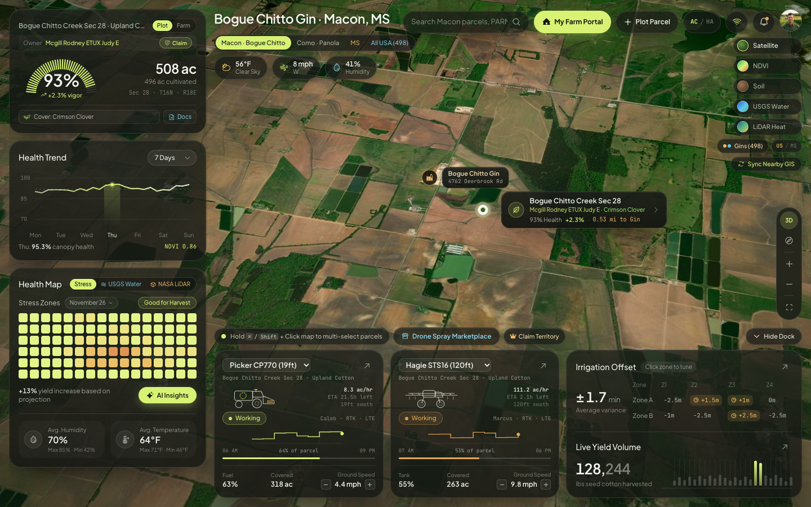
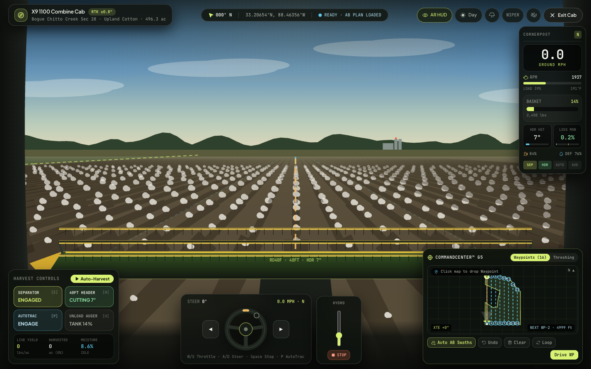
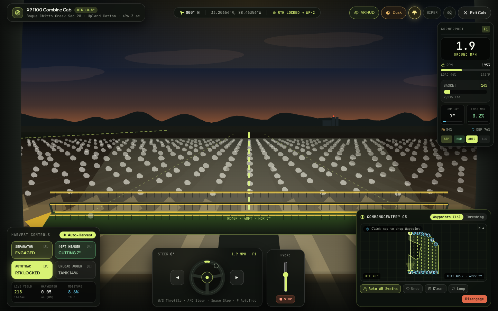

# DeltaPlot — Mississippi Parcel Farm Management System

**Live Deployment:** [https://delta-parcel-fms.vercel.app](https://delta-parcel-fms.vercel.app) · **Repository:** [github.com/sardoru/delta-parcel-fms](https://github.com/sardoru/delta-parcel-fms)

A parcel-first precision agriculture operations cockpit built for **Mississippi farmers**, grounded in **official 2024 Mississippi MARIS cadastral farmland parcels** across two major Mississippi row-crop basins on a live 3D-tilted satellite map:

- **Bogue Chitto Gin · Macon, MS (Noxubee County, FIPS `28103`)** — 120 official MARIS 2024 East MS Black Belt Prairie farm parcels (**28,770 surveyed acres / 25,197 cultivated acres**) centered around **Bogue Chitto Gin (`4762 Deerbrook Rd, Macon, MS 39341`)** with live haul-distance telemetry (`mi to Gin`) and Blackland soil series (**Brooksville, Okolona, Leeper, Vaiden, Kipling**).
- **Como, MS (Panola County, FIPS `28107`)** — 120 official MARIS 2024 West MS cultivated farm parcels (**24,087 surveyed acres / 15,433 cultivated acres**) along Hwy 310, US-51, and I-55 with MLRA-134 loess soil series (**Memphis, Loring, Collins, Falaya, Grenada**).
- **All U.S. Cotton Gins & Warehouses (`All USA (498)`)** — Every geocoded **U.S. Cotton Gin (447)** and **U.S. Cotton Warehouse (51)** across all **17 U.S. Cotton Belt states** (`TX`, `GA`, `MS`, `AR`, `NC`, `AL`, `TN`, `LA`, `MO`, `SC`, `CA`, `OK`, `AZ`, `VA`, `FL`, `KS`, `NM`) sourced from `cotton-gin-map.vercel.app`, cross-verified against Esri `PointAddress`, EPA FRS GPS/Air, and MS MARIS 2024 cadastral records (`206 ✓ Rooftop Pin`, `134 ✓ Street / POI`, `158 ~ Approx Area`).
- **In-Cab Combine Harvester Driving & RTK AutoTrac Simulator ([Launch Cab View](https://delta-parcel-fms.vercel.app/?mode=cab))** — First-person panoramic combine cab (`X9 1100` + 40-ft `RD40F` draper/cotton header) playable directly inside any selected Mississippi MARIS parcel with Cornerpost OLED telemetry, interactive steering wheel & HydroHandle throttle, clickable CommandCenter™ G5 autopilot waypoints, Auto AB Swaths, live swath coverage painting, and Day/Dusk harvest lighting.



### In-Cab Combine Harvester Simulator Screenshots





<details>
<summary>View Como, MS (Panola County) Basin Screenshot</summary>


</details>

---

## Overview

DeltaPlot unifies real Mississippi county cadastral boundaries, high-resolution satellite imagery, vegetation vigor diagnostics, USDA NRCS soil series mapping, fleet telemetry, and poly-pipe / pivot irrigation zone calibration inside a single dark-glass spatial HUD.

Out of the box, the application ships with **120 official cultivated farm parcels** around **Como, MS 38619** (totaling **24,087 surveyed GIS acres** and **15,433 cultivated row-crop acres** along Highway 310, US-51, Interstate 55, Compress Rd, Dunlap Rd, Old Panola Rd, Wilborn Creek, and Holston Rd) — and can dynamically query additional Mississippi parcels anywhere in the viewport directly from the live **MARIS 2024 Cadastral ArcGIS REST API**.

---

## Key Features

### 1. Live 3D-Tilted Geospatial Parcel Map (MapLibre GL JS)
- **High-Resolution Satellite Imagery:** Powered by Esri World Imagery with subtle transportation and place reference overlays so growers can orient by real roads (`I-55`, `US-51`, `MS-310`, `W Oak Ave`) without obscuring crop rows.
- **3D Oblique Aerial & 2D Survey Modes:** Launches in a 48° oblique 3D aerial pitch (`3D` toggle switches cleanly to 0° top-down cadastral survey view).
- **Interactive Cadastral Selection:** Click any of the 120+ Panola County farm parcels to smoothly fly to it, illuminate its exact surveyed boundary in luminous chartreuse, and refresh all analytics, weather, irrigation, and dossier panels.
- **Multi-Layer Spectral & Soil Modes:**
  - **Satellite:** Natural-color aerial imagery with glowing active parcel boundary and hover previews.
  - **NDVI:** Parcel-wide vegetation vigor index color overlay (`0.34 – 0.92` scale).
  - **Soil:** Panola County MLRA-134 soil series overlay (**Memphis Silt Loam**, **Loring Silt Loam**, **Collins Silt Loam**, **Falaya Silt Loam**, **Grenada Silt Loam**).
- **Live MARIS GIS Viewport Sync (`Sync MARIS GIS`):** Pan anywhere across Panola, Tate, Quitman, Tunica, DeSoto, Leflore, or neighboring West Mississippi counties and pull live 2024 cultivated farm parcels (`CULT_AC1 >= 25 OR GISACRES >= 50`) straight from `gis.mississippi.edu`.
- **Geodesic Parcel Plotter (`+ Plot Parcel`):** Click 3 or more GPS vertices directly on the satellite map to survey custom sub-fields or management blocks with real spherical-earth geodesic acreage calculation, persisted to `localStorage`.

### 2. Precision Agronomy & Stress Analytics (Left Rail)
- **Segmented Health Arc Gauge & Area KPI:** Toggle seamlessly between **Plot** (active parcel GIS vs. cultivated acreage and PLSS Section-Township-Range) and **Farm** (whole-operation aggregate), plus instant **AC / HA** and **°F / °C** unit conversion.
- **Health Trend Waveform:** Interactive `7 Days`, `14 Days`, and `30 Days` canopy vigor & NDVI time-series chart with hover scrubbing and optimal threshold baseline.
- **Health Map (`Stress Zones`):** 16×6 sub-parcel spatial stress heatmap. Hovering any zone inspects local moisture %, NDVI, and agronomic stress cause (e.g., Loring fragipan moisture deficit or terrace runoff) while simultaneously projecting a pulsing crosshair at that exact sub-zone inside the selected parcel on the map.
- **AI Agronomy Insights (`AI Insights`):** Parcel-specific MSU Extension & USDA-NRCS aligned prescriptions (harvest windows, variable-rate lime recommendations, MLRA-134 loess erosion control, EQIP eligibility) with one-click scheduling into the parcel operations log.

### 3. Live Fleet, Irrigation Offset & Harvest Telemetry (Bottom Dock)
- **Equipment Telemetry Cards (`Tractor T-04` & `Sprayer S-01`):** Isometric technical wireframes, live `Online` / `Working` status, RTK/LTE telemetry badges, stepped shift duty-cycle graphs, fuel/tank/area/speed readouts, and click-to-inspect parcel dispatch reassignment.
- **Interactive Irrigation Offset Calibration:** Live `Zone A` / `Zone B` (`Z1–Z4`) timing offset matrix for poly-pipe, surge valves, and center-pivot spans. Click any zone offset cell to step-calibrate timing (`±0.5 min`) and recalculate average variance in real time.
- **Live Yield Volume:** Real-time harvest mass readout (`lbs` / `kg`) and load-interval pulse spectrum tailored to each parcel's crop.

### 4. Real-Time Como Weather & Panola County Cadastral Dossier
- **Live Como, MS Weather:** Fetches live temperature, wind speed & compass bearing, humidity, and sky condition for Como (`34.5101°N, -89.9401°W`) via Open-Meteo with resilient offline defaults.
- **Parcel Dossier Drawer:** Displays official Panola County assessor records (`PARNO`, `PLSS`, `Legal Description`, `Site Address`, `2024 Assessed Land Value`, `Surveyed vs. Cultivated Acres`), USDA soil pH/CEC/drainage specs, live **Field Activity Logger**, and one-click **JSON Parcel Export**.

### 5. In-Cab Combine Harvester Driving & RTK AutoTrac Simulator
- **First-Person Panoramic Windshield:** 60fps perspective view over the real selected MARIS parcel polygon with converging crop rows (white cotton bolls, corn stalks, soybeans, sorghum, or wheat), live harvested stubble swaths, animated 40-ft `RD40F` draper header with spinning pickup reel & hydraulic raise/lower (`4"–44"`), chaff/dust plumes, Day/Dusk mode with LED work-light beams, windshield wiper, and AR windshield guidance corridor.
- **Right A-Pillar Cornerpost OLED Display:** Live ground speed (`MPH`), drive range (`F1 / F2 / N / R`), engine RPM & load %, coolant °F, live grain tank / cotton basket fill %, header height gauge, shoe & rotor loss monitor, fuel/DEF %, and `SEP / HDR / AUTO / AUG` annunciators.
- **Interactive Steering, HydroHandle & CommandCenter™ G5 Waypoints:** Drag the 3-spoke steering wheel or drive with `W/A/S/D` & Arrow keys, drop custom waypoints by clicking anywhere on the live parcel map, generate parallel **Auto AB Swaths**, engage **RTK AutoTrac (`P`)** pure-pursuit autopilot with live Cross-Track Error (`XTE`), inspect **Threshing** diagnostics (Dual Rotor RPM, Cleaning Fan RPM, Concave Clearance), and log harvested acreage directly back to the parcel dossier upon exiting.

---

## Tech Stack

| Layer | Technology |
| --- | --- |
| Framework | React 19 + TypeScript + Vite 6 |
| Styling | Tailwind CSS v4 + Self-hosted `Plus Jakarta Sans` & `JetBrains Mono` (`@fontsource`) |
| Mapping & WebGL | MapLibre GL JS `v4.7.1` |
| Icons | `@phosphor-icons/react` |
| Cadastral GIS Data | Official Mississippi MARIS 2024 Statewide Parcels (`MS_Parcels_August_2024` / Panola County FIPS `28107`) |
| Satellite Imagery | Esri World Imagery + World Transportation / Boundaries & Places |
| Live Weather | Open-Meteo Forecast API (`34.5101°N, -89.9401°W`) |
| Hosting | Vercel (static SPA) |

---

## Project Structure

```text
delta-parcel-fms/
├── docs/
│   ├── preview-macon.png            # Live Bogue Chitto Gin — Macon, MS dashboard screenshot
│   ├── preview-combine-cab.png      # In-cab Combine Harvester interior (Daytime Harvest)
│   ├── preview-combine-dusk.png     # In-cab Combine Harvester interior (Dusk Auto-Harvest)
│   └── preview.png                  # Live Como, MS dashboard screenshot
├── public/
│   ├── assets/
│   │   └── farmer-avatar.jpg        # Operator profile portrait
│   └── data/
│       ├── bogue-chitto-macon-parcels.geojson
│       ├── como-ms-parcels.geojson
│       ├── ms-cotton-facilities.json
│       └── us-cotton-facilities.json
├── src/
│   ├── components/
│   │   ├── BottomTelemetryDock.tsx  # Fleet wireframes, irrigation offset tuner, live yield spectrum
│   │   ├── CombineCabSimulator.tsx  # In-cab Cornerpost OLED, steering wheel, HydroHandle & CommandCenter G5
│   │   ├── CombineWindshieldCanvas.tsx # 60fps panoramic perspective field, 40-ft header & AR HUD renderer
│   │   ├── InspectorDrawers.tsx     # Cadastral dossier, AI agronomy drawer, equipment dispatch
│   │   ├── LeftAnalyticsRail.tsx    # Segmented health gauge, trend chart, 16x6 stress heatmap
│   │   ├── ParcelMapStage.tsx       # MapLibre GL 3D satellite stage, MARIS sync, geodesic plotter
│   │   └── TopHudBar.tsx            # Live weather pills, parcel/facility search, Drive Combine button
│   ├── data/
│   │   ├── msParcels.ts             # MARIS feature hydration, regional soils, fleet & alerts
│   │   └── regions.ts               # Macon (Noxubee) & Como (Panola) region definitions
│   ├── types/
│   │   └── farm.ts                  # TypeScript domain models (Parcel, Equipment, CottonFacility, etc.)
│   ├── utils/
│   │   ├── combineSim.ts            # Combine vehicle physics, HarvestGrid & RTK Pure-Pursuit autopilot
│   │   └── units.ts                 # Geodesic area (spherical excess), bbox, AC/HA & °F/°C formatters
│   ├── App.tsx                      # State orchestration, MARIS live fetch, Open-Meteo weather
│   ├── index.css                    # Smoked obsidian glass tokens, fonts, animations
│   └── main.tsx                     # Application entry point
├── vercel.json                      # Vercel Vite SPA deployment configuration
├── vite.config.ts
└── package.json
```

---

## Local Development

### Prerequisites
- Node.js `>= 20`
- npm `>= 10`

### Run Locally
```bash
git clone https://github.com/sardoru/delta-parcel-fms.git
cd delta-parcel-fms
npm install
npm run dev
```
Open `http://localhost:5173` in your browser.

### Production Build
```bash
npm run build
npm run preview
```

---

## Data Attribution & Sources
- **Cadastral Parcel Polygons & Assessor Metadata:** Mississippi Automated Resource Information System (**MARIS**) / MDEQ / Panola County Tax Assessor (`MS_Parcels_August_2024`).
- **Satellite Base Tiles:** Esri, Maxar, Earthstar Geographics, and the GIS User Community.
- **Weather Telemetry:** [Open-Meteo](https://open-meteo.com/) real-time forecast API.
- **Agronomy & Soil Context:** USDA-NRCS MLRA 134 (Southern Mississippi Valley Silty Uplands — Panola County) & Mississippi State University Extension row-crop management baselines.
